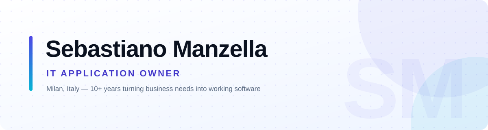

  <picture>
    <source media="(prefers-color-scheme: dark)" srcset="assets/banner-dark.svg">
    <source media="(prefers-color-scheme: light)" srcset="assets/banner-light.svg">
    
  </picture>

**👋 Ciao, I'm Sebastiano!**

---

I'm a computer science engineer from Sicily, based in Milan, with **10+ years** spent somewhere between architecture and shipping software. I'm an **IT Application Owner** at [Generali](https://www.generali.com), where I look after the lifecycle of enterprise applications. I deal with solution and change design, technical and architectural impact assessment, vendor coordination, risk management, and cybersecurity remediation.

In the past, I built cloud-native backends with AWS microservices and serverless components at **BeRebel** (Unipol Group), APIs and integration platforms at **Leithà** (Unipol Group), and Italian-language NLP services for **Samsung Bixby** at **HARMAN**. At **Engineering** I started out in the SOA/EAI world with TIBCO and Oracle.

What I enjoy most is the bridge: taking a messy business need, turning it into a solution that holds up technically, and staying with it until it runs in production. 

Lately, I've been focused on **Databricks** and **Microsoft Fabric** for data platforms, developing with TypeScript and Python.

### What I do

- 🏛️ **Application ownership** — lifecycle, service delivery, change management, governance, technical risk and end-of-life planning.
- ☁️ **Cloud & data architecture** — serverless and microservices on AWS, Data Warehouse / Data Lake design with Databricks and Microsoft Fabric.
- 🧩 **Engineering** — backend services, REST APIs, Infrastructure as Code, CI/CD pipelines, and the occasional frontend.
- 🔐 **Security & quality** — VAPT remediation, cybersecurity assessments, source-code quality, and technical debt worth paying down.

### Tech I reach for

### Where to find me

- 💼 On [LinkedIn](https://www.linkedin.com/in/sebastiano-manzella-b19421a8)
- 🐙 Right here on [GitHub](https://github.com/sebysr)
- ✉️ By email at [sebastiano.manzella@gmail.com](mailto:sebastiano.manzella@gmail.com)
- 📍 In Milan, Italy — always happy to talk about technologies, cloud or data over a coffee
